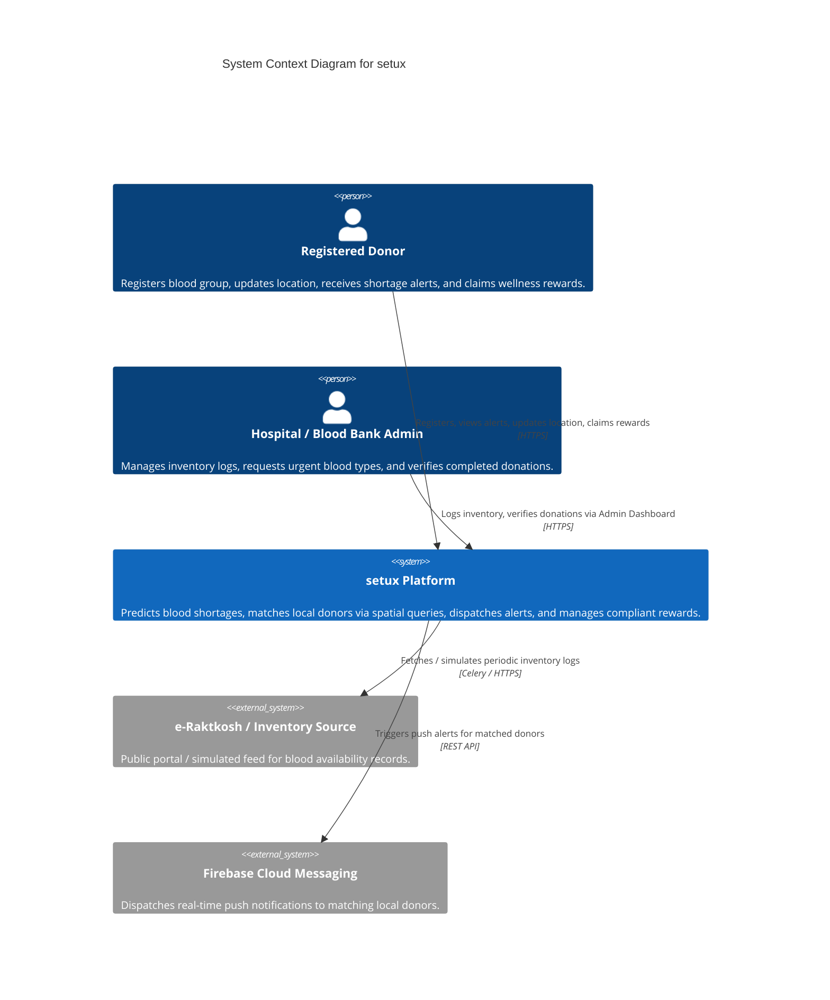
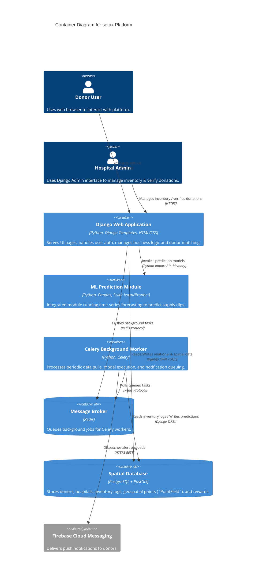

# setux — Proactive Blood Shortage Prediction & Localized Donor Reward Platform

## 1. Project Overview & About

**setux** is an automated, proactive blood shortage prediction and localized donor reward platform designed to resolve blood scarcity issues in India. By integrating time-series machine learning models with location-based spatial querying, **setux** anticipates blood inventory drops below critical safety thresholds at specific hospitals or regional blood centers before shortages manifest.

When a shortage is predicted, the platform executes precise spatial queries to locate registered donors with matching blood types within a specified geographic radius (e.g., 5–10 km) of the facility in need. Targeted alerts are dispatched to donors, who are motivated to donate through non-monetary, wellness-oriented rewards (such as free doctor consultations, health checkups, or partner perks), fully complying with the Indian National Blood Policy (2002) and the _Drugs and Cosmetics Act, 1940_.

---

## 2. Technical Stack Architecture

The platform operates on a **Unified Python Stack with Django**, eliminating multi-language microservice overhead while fully supporting data processing, spatial database querying, and machine learning models within a single, maintainable framework.

| Architectural Component     | Technology                              | Role & Key Responsibilities                                                                                              |
| :-------------------------- | :-------------------------------------- | :----------------------------------------------------------------------------------------------------------------------- |
| **Frontend UI**             | HTML5, CSS3 & Django Templates          | Renders dynamic user interfaces directly from Python without requiring complex JavaScript frontend frameworks.           |
| **Backend API & Core**      | Python & Django Framework               | Manages user authentication, business logic, security protocols, donor reward tracking, and built-in Admin interface.    |
| **Database Layer**          | PostgreSQL + PostGIS Extension          | Stores donor, hospital, and inventory records while executing geospatial SQL queries (`PointField`) for radius matching. |
| **Machine Learning Engine** | Python (Pandas, Scikit-Learn / Prophet) | Cleans inventory logs, models historical trends, and executes time-series shortage prediction algorithms.                |
| **Task Queue & Automation** | Celery & Redis                          | Orchestrates asynchronous background tasks (inventory log updates and notification jobs) without blocking web traffic.   |
| **Authentication & Alerts** | Django Auth & Firebase (FCM / Auth)     | Handles secure user sign-in, account security, location updates, and pushes real-time alert notifications to donors.     |
| **Cloud Hosting / Infra**   | Render / Railway / Docker               | Hosts the application server, PostgreSQL/PostGIS instance, and Redis broker.                                             |

---

## 3. C4 Architecture Diagrams

### Level 1: System Context Diagram

Shows how donors, hospital admins, and external entities interact with **setux**.



---

### Level 2: Container Diagram

Explores the internal deployable containers powering **setux**.



---

### Level 3: Component Diagram (Django Backend Container)

Breaks down the structural components within the primary **Django Application Container**.

```mermaid
C4Component
    title Component Diagram - Django Application Container

    Container(postgisDb, "Spatial Database", "PostgreSQL + PostGIS", "Stores models and geospatial records.")

    ContainerContext(djangoApp, "Django Application Container") {
        Component(authComp, "Auth & Profile Component", "Django Auth, User Views", "Handles donor login, profile management, and blood group registrations.")
        Component(adminComp, "Hospital Admin Dashboard", "Django Admin Panel", "Out-of-the-box interface for blood banks to manage stock and verify donations.")
        Component(matchingComp, "Spatial Matching Engine", "GeoDjango, PostGIS Queries", "Runs geographic radius queries (`PointField`) to match O/A/B/AB donors near hospitals.")
        Component(rewardComp, "Reward & Verification Engine", "Django Views & Models", "Manages reward rules, verifies completed donations, and unlocks doctor appointment perks.")
        Component(mlRunner, "Prediction Engine Service", "Joblib / Scikit-learn Integration", "Loads saved time-series model and executes forecasts on inventory trends.")
    }

    Rel(authComp, postgisDb, "Reads/Writes User Profiles", "Django ORM")
    Rel(adminComp, postgisDb, "Updates Inventory / Verifies Donations", "Django ORM")
    Rel(matchingComp, postgisDb, "Executes ST_DWithin Radius Queries", "GeoDjango ORM")
    Rel(rewardComp, postgisDb, "Grants & Tracks Unlocked Perks", "Django ORM")
    Rel(mlRunner, postgisDb, "Fetches Historical Stock Logs", "Django ORM")
```

---

## 4. Implementation Plan for Copilot (8-Week Roadmap)

This step-by-step implementation plan provides structured checkpoints for automated assistance or team copilot execution across an 8-week timeline.

```
┌─────────────────────────────────────────────────────────────────────────┐
│                      8-WEEK IMPLEMENTATION ROADMAP                      │
├──────────────────┬──────────────────┬──────────────────┬────────────────┤
│   WEEKS 1 - 2    │   WEEKS 3 - 4    │   WEEKS 5 - 6    │  WEEKS 7 - 8   │
│ Django Foundation│ GeoLocation & GIS│ ML & Forecasting │  Integration & │
│  & Base Models   │ Spatial Queries  │ Data Simulation  │ Background Jobs│
└──────────────────┴──────────────────┴──────────────────┴────────────────┘
```

---

### Phase 1: Django Foundation & Base Project Setup (Weeks 1 – 2)

- **Objective:** Initialize the project skeleton, configure local environment variables, set up core Django apps, and establish base database models.
- **Copilot Execution Tasks:**
  1. Initialize local virtual environment (`python -m venv venv`) and lock dependencies (`pip freeze > requirements.txt`).
  2. Bootstrap Django project:
     ```bash
     django-admin startproject config .
     python manage.py startapp core
     python manage.py startapp donors
     python manage.py startapp inventory
     python manage.py startapp rewards
     ```
  3. Create standard Django templates layout (`templates/base.html`, `templates/landing.html`, `templates/login.html`).
  4. Build Django ORM models for `Donor`, `Hospital`, `BloodInventory`, and `Reward`.
  5. Configure Django Admin Panel as an out-of-the-box interface for hospital stock management and donation verification.

---

### Phase 2: Geolocation & Spatial Matching (Weeks 3 – 4)

- **Objective:** Enable hosted PostGIS and deliver a complete radius-based shortage request workflow without requiring GeoDjango or native GDAL on developer machines.
- **Implemented approach:** Supabase PostgreSQL stores nullable latitude/longitude fields. Django uses the standard PostgreSQL backend and calls PostGIS directly through parameterized `ST_Distance` SQL.
- For local SQLite development, donor matching uses a Haversine-distance fallback; deployment should use PostgreSQL with PostGIS enabled.
- **Completed tasks:**
  1. Enabled and verified PostGIS in Supabase.
  2. Added donor location capture, coordinate validation, and profile editing.
  3. Added healthcare-center shortage requests with blood group, units needed, and radius controls.
  4. Added center-scoped and operations dashboards for reviewing nearby eligible donors.
  5. Verified a live temporary donor match against Supabase and removed all probe records afterward.

  ```python
  donor_point = "ST_SetSRID(ST_MakePoint(longitude, latitude), 4326)::geography"
  hospital_point = "ST_SetSRID(ST_MakePoint(%s, %s), 4326)::geography"
  distance = RawSQL(
    f"ST_Distance({donor_point}, {hospital_point})",
    [hospital.longitude, hospital.latitude],
  )
  ```

### Current Implementation Status

- Phase 1 foundation, models, admin screens, donor authentication, and templates are implemented.
- Phase 2 is implemented end to end: donor location capture/editing, healthcare-center shortage requests, PostGIS radius matching, center-scoped match results, and operations/admin views.
- Phase 3 includes reproducible synthetic daily inventory generation (up to two years), idempotent seeding, a recent-history linear-regression forecast, and hospital/operations risk dashboards.
- Forecast records are simulated and are not real stock data. No external donor-demographics dataset or saved model artifact is currently used; forecasts are fitted from each facility's recorded inventory.
- Phase 4 includes Celery/Redis scheduled jobs, in-app shortage/forecast alerts, hospital donation verification, and donor reward claims.
- Firebase Cloud Messaging web push is optional and must be configured with Firebase credentials.

---

### Phase 3: Data Engineering, Simulation & Shortage Forecasting (Weeks 5 – 6)

- **Implemented:** A deterministic Python generator creates daily synthetic inventory, including seasonal pressure and periodic replenishment. A least-squares linear regression uses up to the latest 90 stock records to forecast the next seven days and classify risk.
- **Seed synthetic history** after configuring the database:
  ```powershell
  python manage.py seed_forecast_data
  ```
  This generates one year of records per blood group. Use `--days 730` for two years, or `--hospital-id <id>` to limit generation to one active hospital. The command creates a demo Pune center only when there are no active hospitals. Generated records are simulated and should not be treated as real inventory.
- Hospital staff see their forecast on the center dashboard; operations staff see centers with high- or watch-risk forecasts.
- External donor-demographics ingestion and serialized model files are not included: they are not required by this inventory-only forecast, which fits its regression directly from recorded history.

---

### Phase 4: Automation, Celery Integration & Final UI (Weeks 7 – 8)

- **Implemented:** Celery/Redis scheduling, database-backed in-app alerts for nearby donors when shortages or forecast risks are detected, center-side donation verification, donor reward claiming with one-time codes, and admin audit screens. New shortage requests notify matching donors immediately with hospital location details; eligible donors can accept a request and propose a donation time, which hospital staff can review from the request details.
- Configure `REDIS_URL` in `backend/.env`. Redis must be running and reachable for background work. On Windows, use a local Redis-compatible service, WSL, or a hosted Redis URL.
- Run the app and worker processes in separate terminals from `backend`:
  ```powershell
  # Terminal 1: Django
  python manage.py migrate
  python manage.py runserver

  # Terminal 2: Celery worker (solo pool is required on Windows)
  celery -A config worker --pool=solo -l info

  # Terminal 3: scheduled jobs (shortage alerts every 5 minutes; forecasts daily at 08:00)
  celery -A config beat -l info
  ```
- Hospital staff verify donations on their center dashboard. Add active non-cash rewards in Django Admin first; staff can select one during verification. Donors see alerts and reward claims on their dashboard and can reveal their claim code after claiming.
- **Optional Firebase web push setup:**
  1. Create a Firebase project, register a Web app, enable Cloud Messaging, and generate a Web Push certificate (VAPID key).
  2. Download a Firebase Admin service-account JSON file and keep it outside source control. The backend `.gitignore` excludes common service-account filenames.
  3. Copy the public Web app configuration and VAPID key into the `FIREBASE_*` variables in `backend/.env` (create it from `.env.example`). Set `FIREBASE_ENABLED=1` and `FIREBASE_CREDENTIALS_PATH` to the service-account file's absolute path. Firebase Web API configuration and VAPID values are public identifiers; never put service-account JSON contents in `.env`, HTML, or source code.
  4. Apply migrations, restart Django, Celery worker, and Celery Beat. Donors opt in from their dashboard using a supported browser on HTTPS or localhost. Pending alerts are delivered to registered devices by Celery; in-app alerts continue to work without Firebase.
- Donors can disable push on the current browser from the dashboard. Disabling push does not affect in-app alerts or other registered devices.
- Firebase delivery has not been tested against a live Firebase project. Risk forecasts and synthetic inventory should not be treated as verified real-world shortage evidence.

---

## 5. Division of Labor for the 4-Member Team

| Team Member  | Domain & Role                    | Primary Responsibilities                                                                                                                    |
| :----------- | :------------------------------- | :------------------------------------------------------------------------------------------------------------------------------------------ |
| **Member 1** | Frontend UI & Django Templates   | Converts static designs into dynamic Django HTML/CSS templates, builds donor registration, profile, and reward dashboards.                  |
| **Member 2** | Backend API & Business Logic     | Implements core Django views, user authentication, matching algorithms, and reward verification logic.                                      |
| **Member 3** | Data & Machine Learning Engineer | Cleans data, constructs synthetic daily inventory logs with seasonal trends, and trains the time-series forecasting model.                  |
| **Member 4** | Spatial DB & System Automation   | Manages PostgreSQL/PostGIS databases, writes spatial SQL queries, configures Celery + Redis background tasks, and handles cloud deployment. |

---

## 6. Compliance, Legal & Verification Framework

1. **Non-Monetary Incentive Compliance:**
   - Under the **National Blood Policy (2002)** and the _Drugs and Cosmetics Act, 1940_, buying or selling blood packets in India is strictly illegal.
   - All donations on **setux** are Voluntary, Non-Remunerated, and Unpaid (VNRD).
   - Rewards are strictly non-cash and wellness-oriented (e.g., free follow-up doctor consultations, basic health checkups, or partner refreshment vouchers). Direct cash, bank transfers, or cash-equivalent gift cards are strictly prohibited.

2. **Donation Verification Flow:**
   - Donors receive a localized alert, navigate to the hospital, and complete their blood donation.
   - Hospital administrators verify the transaction by entering the donor ID or confirming the donor record inside the built-in Django Admin dashboard.
   - Upon verification, the platform automatically issues a digital token/certificate unlocking the non-monetary partner reward (e.g., free doctor appointment) on the donor's profile.
